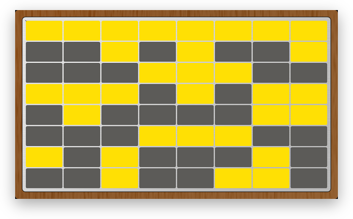

OSCream is a music app that turns a touchscreen into an OSC controller emulating the monome grid and arc.

<video width="400" controls autoplay>
    <source src="/assets/software/oscream-edm.mov" type="video/quicktime">
</video>

## The story so far

**2011: BlackBerry PlayBook.** OSCream started as my first app for the BlackBerry PlayBook, written in ActionScript with Adobe AIR, two things I had never touched before. The first version shipped on BlackBerry App World in March 2011 with a single surface, an 8×8 grid emulating the monome 64, tested with monome patches in Max and Pure Data. A few weeks later came a beta of the arc surface, played with arc patches such as Plates.

**2012: Android.** Since Adobe AIR also ran on Android, OSCream followed in January 2012 as a beta for Android phones, with both the grid and arc emulators. It needed a fairly powerful device, but it ran well.

**2014: the end of the line.** In 2014 BlackBerry announced that Adobe AIR would no longer be supported on BB10. Keeping an AIR app alive for Android alone, with all the limits of the platform, no longer made sense, so I stopped working on OSCream. It has since disappeared from the stores.

**Next: back in Swift.** The idea never went away. OSCream is coming back, rewritten from scratch in Swift for Apple devices. More news here when there is something to play with.
